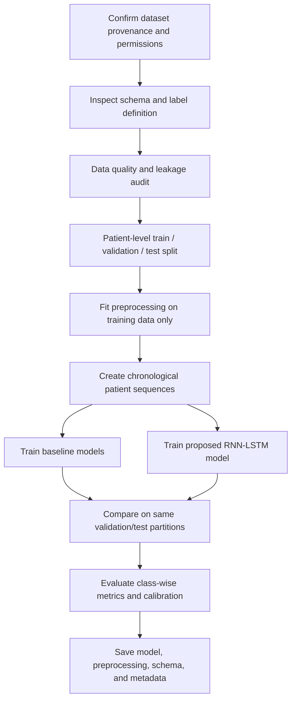
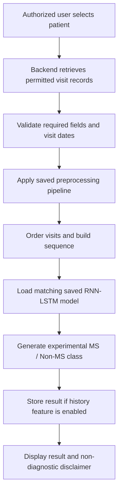
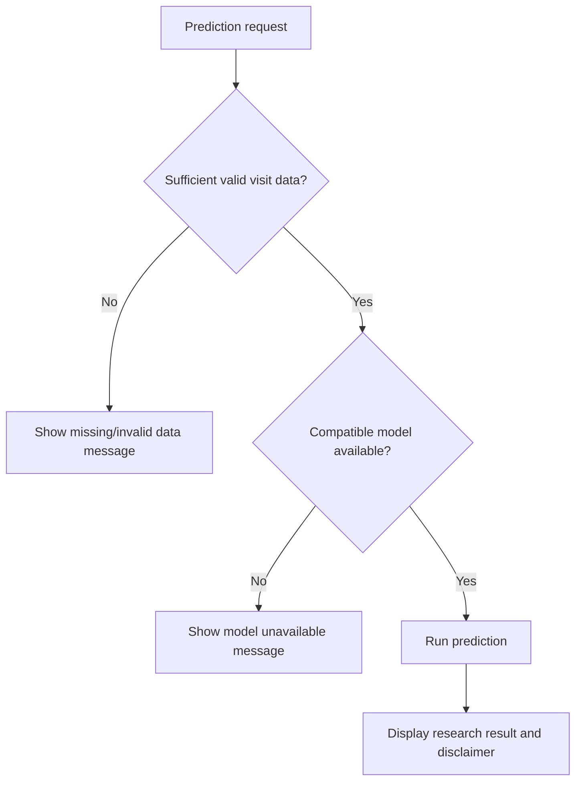

# 06 — Project Workflows

## A. Dataset and model-development workflow

## B. Prediction-time workflow

## C. Error workflow

## D. System data-flow summary

- The user submits patient/visit details and requests a prediction.
- The frontend sends structured requests to the backend.
- The backend validates data and reads/writes permitted records in the database.
- The inference pipeline retrieves chronological visits and applies saved preprocessing.
- The saved model produces a predicted class.
- The backend returns the result to the frontend.

## E. Model-training versus inference distinction

Training is an offline development activity. It uses labelled dataset partitions to train and evaluate the model. Prediction-time inference reuses the saved model and fitted preprocessing artifacts; it does not train the model again for each patient.
