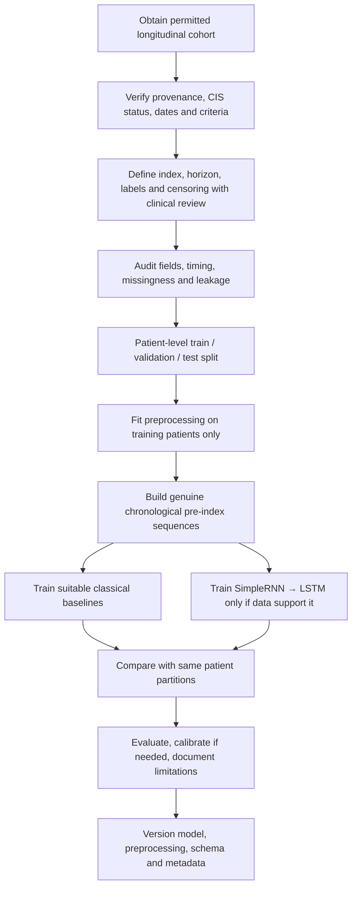
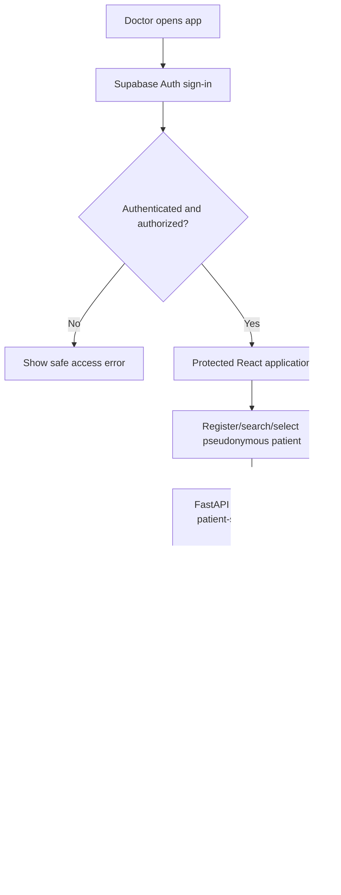
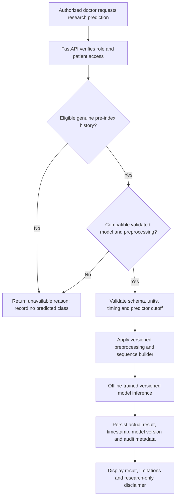

# 06 — Project Workflows

## A. Approved cohort and model-development workflow

The current public Mexican and Lithuanian interim files do not pass the cohort/label gate. Do not manufacture a sequence, label, conversion date, or performance result from them.

## B. Doctor application access and patient management workflow

## C. Gated research prediction workflow

Until the approved cohort and validated artifact gates pass, prediction requests must remain unavailable. A logged unavailable request is not a prediction result.

## D. Prediction history workflow

An authorized doctor opens a patient record → the backend verifies patient-level access → retrieves only permitted request/result events → displays them chronologically with status, timestamp, and model/preprocessing version where applicable. Only real service outcomes may be shown; failed/unavailable requests must not display a class.

## E. Error and safety workflow

- Authentication or authorization failure → deny request and return a safe message; do not disclose whether inaccessible patient data exist.
- Invalid field, unit, date, relationship, or schema → reject with a field-level explanation that contains no sensitive values.
- Insufficient visits, unknown outcome status, unavailable/incompatible model, or unsupported data → do not predict; show why the request is unavailable.
- Database or inference failure → record only approved safe audit metadata and return a generic safe error; never fabricate a result.

## F. Architecture and training/inference separation

React/TypeScript sends authorized structured requests to FastAPI. FastAPI validates authorization and payloads, coordinates SQLAlchemy operations against Supabase PostgreSQL under RLS, and calls a separate inference component only for a compatible validated model. Offline training consumes approved research data and produces versioned model/preprocessing artifacts; it is never run in a user request.
