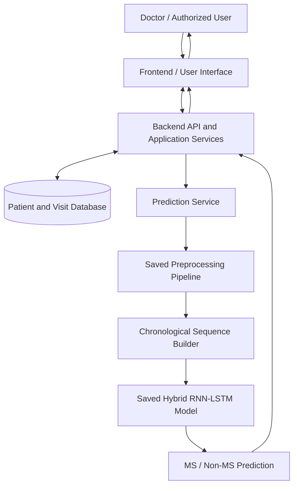
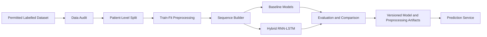

# 07 — Proposed System Architecture

## 1. Architectural style

A simple layered architecture is recommended for the first working prototype. Keep the ML pipeline independently testable and avoid coupling model code directly to UI code.

## 2. Components

### Presentation layer
- Patient selection/registration (if approved).
- Visit entry or dataset-backed patient-history view.
- Prediction request form.
- Results page with model version and disclaimer.

### Application/API layer
- Request validation.
- Patient and visit services.
- Prediction orchestration.
- Error handling and audit metadata.

### Data layer
- Patient metadata with pseudonymous identifiers.
- Time-stamped visit records.
- Prediction records, if history is enabled.
- No direct identifiers in development data.

### ML layer
- Dataset schema validation.
- Train-fitted preprocessing.
- Chronological sequence generation.
- Baseline models.
- Hybrid RNN–LSTM training.
- Saved model/preprocessing artifacts.
- Inference service.

## 3. Component diagram

## 4. Offline model-development architecture

## 5. Recommended initial technology choices

- **Backend:** Flask for a compact, beginner-friendly prototype. FastAPI is an alternative; do not use both without a clear reason.
- **Frontend:** Start with server-rendered HTML templates + Bootstrap. Add React only if the interface complexity justifies it.
- **Database:** SQLite for local development. Consider PostgreSQL if concurrent users or deployment requirements justify it.
- **ML:** Python, Pandas, NumPy, scikit-learn, TensorFlow/Keras.
- **Visualization:** Matplotlib or Plotly for research results, if needed.

## 6. Architecture constraints

- Keep training code separate from request-time inference.
- Model artifacts must be versioned and paired with preprocessing artifacts.
- The API must reject incompatible feature schemas.
- A missing or incompatible model must return an error, not a fabricated output.
- Do not add MRI image processing in the current scope.
- The architecture is proposed; it must be updated to match what is actually implemented.
