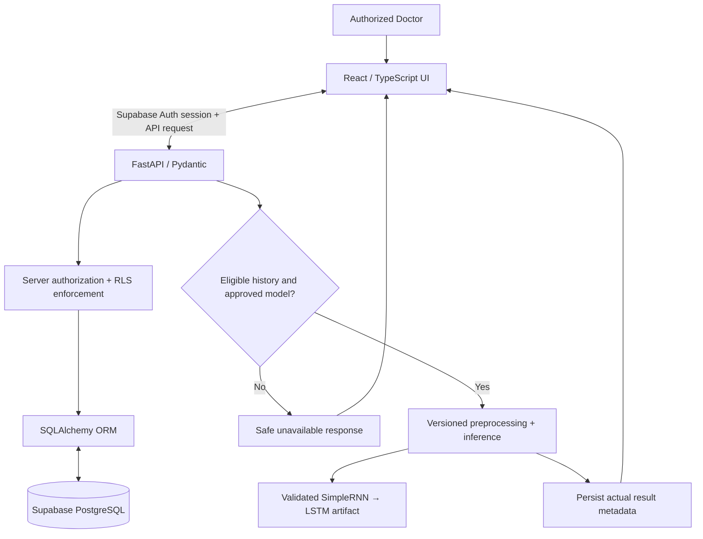

# 07 — Approved System Architecture

## 1. Architecture decision

Use a layered doctor-facing research application. The approved request path is:

```text
React + TypeScript frontend
            ↓ authenticated HTTPS API
FastAPI application and authorization
            ↓
SQLAlchemy ORM / Alembic migrations
            ↓
Supabase PostgreSQL with RLS; Supabase Auth for identity
```

The offline research pipeline is separate:

```text
Permitted clinical cohort → audit/label gate → patient-level split
→ train-only preprocessing → genuine pre-index sequences
→ classical baselines + gated SimpleRNN → LSTM → Dense experiment
→ locked evaluation → versioned model/preprocessing artifacts
→ FastAPI inference only after validation and approval
```

This is the user-approved stack. Do not replace React, FastAPI, or Supabase PostgreSQL with other frameworks or databases without discussing the change first. Training is not part of the request path.

## 2. Mandatory application modules and component responsibilities

### Presentation layer — React/TypeScript

1. **Doctor login/authentication:** sign-in, sign-out, session state, protected routes, role-aware navigation.
2. **Patient registration/management:** pseudonymous patient creation, search, permitted detail view/edit.
3. **Patient visit history:** linked patient timeline in chronological order.
4. **Clinical data management:** approved source-specific clinical fields and structured MRI measurements, with measurement dates/units and validation feedback.
5. **Research prediction:** eligible-history request and result/unavailable state, version metadata, limitations and disclaimer.
6. **Prediction history/results:** authorized patient-scoped events, actual result status, timestamps, model version, and audit metadata.

### Application/API layer — FastAPI

- Authenticate/verify Supabase Auth identity and enforce server-side role/patient authorization.
- Validate request and response models, dates, units, schema versions, and prediction-time availability.
- Provide patient/visit/data-management services and prediction-history access.
- Call model inference only when a compatible approved model/preprocessor is loaded and the history passes eligibility checks.
- Return safe errors and no prediction on any failed gate.

### Persistence layer — SQLAlchemy and Supabase PostgreSQL

- Model pseudonymous patients, genuine dated visits/measurements, actual prediction/request events, and model-version metadata as approved in the later database phase.
- Use foreign keys, uniqueness/consistency constraints, timestamps, least privilege, RLS, and approved audit/retention rules.
- Supabase Auth is the identity provider; never store plaintext passwords or put service-role credentials in the frontend.
- Final clinical columns depend on the approved source data dictionary. This architecture does not authorize storing real patient data yet.

### ML layer — separate Python pipeline

Use Pandas, NumPy, scikit-learn, TensorFlow/Keras, Matplotlib, and Seaborn. Keep source audit, label validation, patient splitting, train-only preprocessing, sequence generation, training, evaluation, and artifact versioning independently testable. The proposed neural architecture is SimpleRNN → LSTM → Dense and is conditional on data suitability.

## 3. Component diagram



## 4. Security and clinical-data boundaries

- All patient-data access passes through authenticated backend authorization and RLS; frontend route protection is not an access-control boundary.
- Store only pseudonymous, permitted fields. No direct identifiers are required by current scope.
- Do not commit patient records, secrets, tokens, or restricted model/data artifacts.
- Keep raw data and training artifacts in approved storage; use synthetic fixtures only for software tests, labelled as synthetic.
- Prediction is unavailable until valid approved clinical data, outcome/index/horizon definitions, fitted preprocessing, and a tested/versioned model exist.
- RLS, hosting, residency, retention, backups, and access policy require later security/governance approval before real data use.

## 5. Current implementation status

Only data audit/preparation and guarded-validation utilities exist. No application, database schema/migrations, authentication integration, inference endpoint, or trained model has been implemented. This architecture specifies intended design, not deployed functionality.
