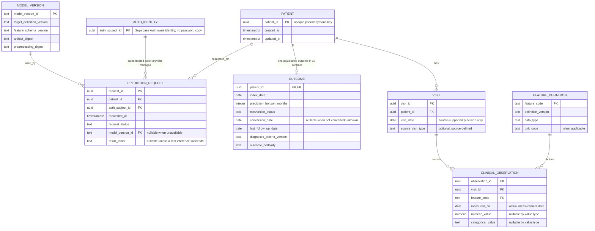

# 15 — Provisional Application Data Architecture

**Status:** Design proposal only; not approved for clinical storage.  
**Purpose:** Establish a reviewable, data-minimized relational shape for the approved research application modules while the longitudinal cohort and governance decisions remain pending.

## 1. Scope and boundary

This design follows the approved Supabase PostgreSQL, Supabase Auth, SQLAlchemy, and Alembic stack. It does not create a Supabase project, database, migration, API connection, patient record, or model result. The Mexican and Lithuanian interim cohorts do not supply application records for this design.

The project owner approved a doctor-facing application with authentication, patient management, visit history, clinical data management, research prediction, and prediction history. The actual clinical columns and value dictionaries remain source-dependent and are intentionally unspecified here.

## 2. Provisional logical ER model

`AUTH_IDENTITY` is a conceptual reference to the Supabase Auth subject, not an application password table. Role assignment and the mechanism for binding a verified JWT to database RLS context remain open security decisions.

## 3. Proposed constraints and indexes

These are design candidates for review; they are not migrations or approved clinical rules.

- Use opaque generated keys for internal records. Keep names, contact details, MRNs, source IDs, and linkage keys out of the default patient table.
- `visits.patient_id` references exactly one patient. Keep actual source-supported visit dates and do not infer missing dates or create repeated visits.
- Each clinical observation references one visit and one versioned feature definition. Its stored value type must agree with that definition; measurement dates and units remain source-supported.
- The current normalized contract permits one outcome per patient. A later multi-landmark protocol would require an explicit outcome/landmark key and patient-grouped evaluation before changing this uniqueness rule.
- Allowed outcome states follow the data contract (`0`, `1`, `unknown`, `censored`). Application validation must enforce the horizon, conversion-date window, and adequate follow-up; a simple database check alone cannot establish clinical adjudication.
- An unavailable or failed request cannot contain a result label. A successful result must reference an immutable model/preprocessing version. No probability column is proposed until calibration and display policy are approved.
- Candidate indexes: visits by `(patient_id, visit_date)`, observations by `(visit_id, feature_code, measured_on)`, outcomes by `(patient_id)`, and requests by `(patient_id, requested_at)`.
- Prediction requests should support an idempotency key if retries are introduced; its semantics are not decided here.

## 4. Access and service boundaries

- Browser traffic goes to FastAPI over authenticated HTTPS. The frontend does not connect directly to patient tables.
- Supabase Auth owns credentials. FastAPI verifies identity and performs patient-scoped authorization; UI route guards are not security controls.
- Database access must use a constrained backend role. A Supabase service-role credential can bypass RLS and must not become a general application connection credential. The concrete JWT/RLS propagation pattern must be reviewed and tested before any patient endpoint is enabled.
- RLS defaults to deny. The required role matrix, doctor onboarding/provisioning, administrator capability, and patient-scope rule are not yet approved.
- Health checks return service status only. Do not include database credentials, patient counts, clinical payloads, source identifiers, or model paths in responses or logs.

## 5. Decisions deliberately left open

1. Which source-approved static patient fields and visit measurements exist, with definitions, units, categories, and timing.
2. Whether observations belong in typed visit columns or a child measurement table after source compatibility is known.
3. Whether a future study uses one baseline outcome or multiple prediction landmarks.
4. Retention, deletion, audit metadata, backup, residency, hosting plan, and institutional approval.
5. Auth role provisioning and a tested, least-privilege FastAPI-to-Postgres RLS context.
6. Whether model artifacts live in approved object storage or another controlled store; the database should keep metadata and digests only.

## 6. Approval gates

Before converting this proposal to migrations or enabling real records, obtain the required governance and security decisions, complete the intended-use workflow review, map all fields to the approved source dictionary, settle retention and role rules, review the RLS connection pattern, and test deny-by-default behavior. Until then this is a provisional logical model, not a permission to store health data.
