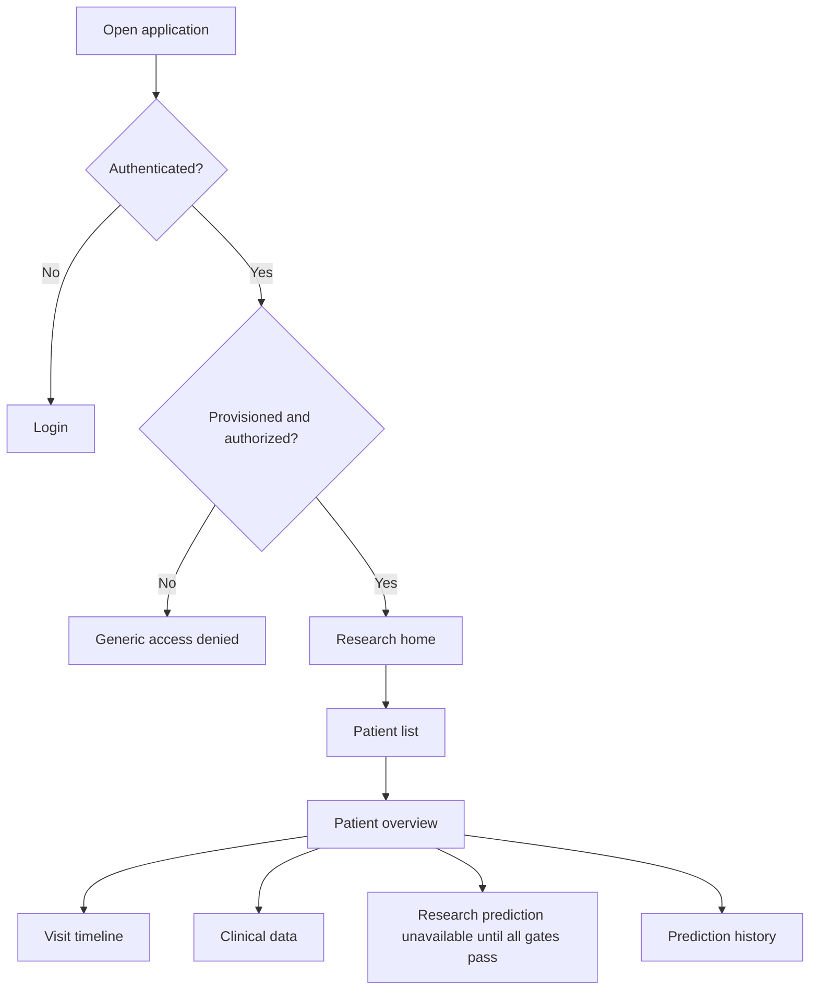

# 17 — Provisional UI/UX Architecture

**Status:** Design slice for a research prototype; not reviewed by clinical users and not approved for patient-data operation.
**Basis:** Approved six-module application scope, existing UI/UX guidelines, system architecture, and the current no-data/no-model state.

## 1. Navigation and route map

Routes are proposed contracts for the React application. All patient routes require an authenticated and server-authorized session when implemented. A client-side route guard is only a usability layer.

| Route | Screen | Current/future behavior |
|---|---|---|
| `/login` | Doctor sign-in | Supabase Auth flow after account provisioning and auth policy are approved. |
| `/access-denied` | Access denied | Generic response; never reveal whether a restricted patient exists. |
| `/` | Research home | Explains project scope, system readiness, and navigation; no clinical values. |
| `/patients` | Patient list/search | Future backend-backed, pseudonymous patient records; show actual authorized results only. |
| `/patients/new` | Register patient | Future form restricted to approved fields and authorized users. |
| `/patients/:patientId` | Patient overview | Future identity-safe summary and links to genuine recorded history. |
| `/patients/:patientId/visits` | Visit timeline | Future actual dated visits sorted chronologically; distinguish missing, not assessed, unavailable, and invalid. |
| `/patients/:patientId/clinical-data` | Clinical data | Future source-approved fields with actual measurement date, unit, and documented validation rules. |
| `/patients/:patientId/prediction` | Research prediction | Unavailable state until dataset, outcome, authorization, and compatible validated model gates all pass. |
| `/patients/:patientId/predictions` | Prediction history | Future patient-scoped real request records; failed/unavailable requests never show a class. |

### Proposed navigation flow

## 2. Shared application shell

- Use a responsive left navigation rail on wide screens and an accessible menu on small screens.
- Keep product name and a concise “Research use only” marker visible. On prediction-related routes, display the full required disclaimer: **“Research prediction only — not a medical diagnosis. Do not use this result to make treatment decisions.”**
- Provide a clear page title, breadcrumb/context, main-content landmark, and consistent page-width/spacing.
- Include account/session controls only after the auth implementation exists. Never display tokens or claim values.
- Use restrained neutral surfaces, dark text, blue/teal accents, clear focus indication, and no diagnostic red/green encoding. Status must also have plain text/icon semantics.

## 3. Component inventory

| Component | Responsibility | Data contract/status |
|---|---|---|
| `AppShell` | Global navigation, page frame, research-use marker | Static shell; no patient data. |
| `RouteGuard` | Route-level sign-in/provisioning UX | Must defer all security to FastAPI; auth state currently unconfigured. |
| `PageHeader` | Title, context, optional actions | Static labels until API contracts exist. |
| `LoadingState` | Non-blocking route/data loading feedback | Must not expose stale patient content across navigation. |
| `ErrorState` | Retryable safe error | Generic text; no SQL/token/internal details. |
| `EmptyState` | No authorized records/result | Must not suggest that unauthorized records do not exist. |
| `UnavailableState` | Missing backend/auth/model/eligibility dependency | Names the unavailable capability without implying a clinical result. |
| `PatientTable` | Future pseudonymous patient list | No direct identifiers; future server paging and authorization. |
| `VisitTimeline` | Future genuine dated clinical observations | Source dates only; no synthetic observations. |
| `ClinicalField` / `ClinicalForm` | Future approved typed feature display/edit | Requires source dictionary, units, timing, validation, and permissions. |
| `PredictionStatusCard` | Future request/result state | No prediction or probability until model/version and workflow gates pass. |
| `PredictionHistoryTable` | Future timestamped, patient-scoped requests | Real records only; no success state before backend confirmation. |

## 4. Required UI states

Every asynchronous or protected screen must distinguish:

- loading;
- unauthenticated/session expired;
- authenticated but not provisioned;
- forbidden or not found with non-disclosing copy;
- empty authorized result;
- validation failure with field-level remediation;
- retryable service/network failure;
- unavailable because database, authentication, model, or study eligibility is not configured;
- successful response only after confirmed backend success.

For the current application, patient, clinical-data, prediction, and history modules have no enabled backend. The correct screen state is “not configured/unavailable”; no demo rows, synthetic patients, sample prediction labels, or fabricated history should be shipped as genuine content.

## 5. Accessibility and responsive acceptance checklist

- All navigation, dialogs, forms, tables, and timeline controls work by keyboard, with visible focus and logical order.
- Use semantic landmarks, headings, labels, button names, table headers, and accessible status announcements.
- Do not communicate meaning by color alone; support zoom/reflow and small-screen navigation.
- Maintain readable text and verify color contrast against WCAG AA for chosen tokens before visual acceptance.
- Validation text is associated with fields; error summaries are announced and focus can move to the first invalid field.
- Respect reduced-motion preferences; animation is optional and never conveys required state.
- Test with keyboard-only navigation and a screen reader before claiming accessibility acceptance.

## 6. Design tokens — initial proposals

The existing handoff chooses a neutral light canvas, navy text, and restrained blue/teal accents. Exact color values, typography, spacing, and component states remain implementation choices and require contrast verification and responsive review. Avoid claiming WCAG conformance until measured and tested.

## 7. Explicitly deferred design decisions

1. Representative clinician/user review and confirmation of workflow terminology.
2. Final patient scope, authorized patient count/list behavior, and privacy-safe error wording.
3. Approved clinical fields, data dictionary-driven forms, units, validation, and missingness vocabulary.
4. Final login/account-provisioning, MFA, session-expiry, recovery, and access-denied workflows.
5. Prediction eligibility criteria, outcome horizon, displayed metrics, model version metadata, and result presentation; these depend on clinical/data approval and a validated model.
6. Final responsive component implementation and measured accessibility review.

## 8. Acceptance boundary

This document supplies a provisional route map, component/state inventory, and safety/accessibility requirements for the static frontend foundation. It does not complete Phase 49: user/workflow review, visual implementation, contrast measurement, accessibility testing, and model-specific behaviors remain outstanding. The React scaffold must remain non-clinical and avoid real-record access until the relevant phases and approvals are satisfied.
