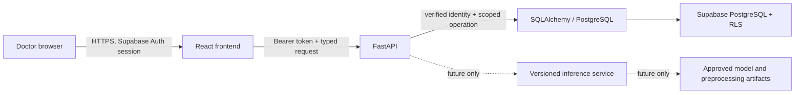

# 18 — Provisional Application and Research Pipeline Threat Model

**Status:** Architecture planning only. This is not a security audit, penetration test, privacy impact assessment, institutional approval, or evidence of deployed controls.
**Scope:** Identify assets, trust boundaries, plausible threats, and verification gates for the proposed application and separate ML research pipeline.

## 1. System boundaries and sensitive assets

### Proposed application flow

The browser, identity provider, API process, database/connection pool, offline data preparation environment, model artifact store, deployment platform, and logs have separate trust boundaries. Hosting, network placement, key management, identity/account provisioning, and the RLS identity-propagation pattern are not yet selected or validated.

Assets requiring protection before any real-record operation:

- authentication secrets, access/refresh tokens, service credentials, signing keys, and database credentials;
- pseudonymous patient identifiers and any external linkage key (the linkage key should remain outside the application unless separately authorized);
- clinical observations, dates, outcomes, visit histories, and source/provenance metadata;
- research labels, feature mappings, cohort inclusion/exclusion decisions, and patient-level split assignments;
- model/preprocessing artifacts, digests, model-version metadata, and actual prediction requests/results;
- audit/security events, backups, error reports, browser bundles, CI logs, and developer workstations.

Pseudonymous records remain sensitive and may be re-identifiable when joined with auxiliary information.

## 2. Actors and trust assumptions

- Authorized, provisioned doctor (role and patient scope not defined yet).
- Authenticated but unprovisioned user, anonymous visitor, disabled account, or expired session.
- External attacker probing public frontend/API surfaces.
- Compromised or malicious authorized account.
- Project maintainer/developer and CI/deployment operator.
- Supabase and eventual hosting/platform operators, under a future reviewed agreement/configuration.
- Data owner, principal investigator, institutional governance/security reviewers, and clinical adjudicators.

No actor or provider is assumed to have clinical authority solely from the application role or selected technology.

## 3. Provisional threat register

Priority expresses potential impact and implementation ordering, not a measured likelihood or completed risk score.

| ID | Threat / failure mode | Potential impact | Priority | Required controls and evidence before relevant use |
|---|---|---|---|---|
| TM-01 | Forged, expired, wrong-issuer/audience, or stale JWT accepted; user-controlled metadata grants a role | Unauthorized account or role access | Critical | Supported JWT verification; fail-closed claims checks; trusted role provisioning; tests for tampering, expiry, issuer/audience, unprovisioned user, claim refresh/revocation. |
| TM-02 | Insecure direct object reference or missing patient-scope check in API route | Cross-patient disclosure or modification | Critical | Server-side authorization for each request; approved patient-scope model; deny-by-default API tests across identities and records. |
| TM-03 | Missing grants, overly broad RLS, unsafe view/function, or exposed table without RLS | Bypass of intended row restriction | Critical | Deliberate grants and per-operation RLS policies on exposed objects; inspect views/functions; database-level allow/deny tests for anon, authenticated, and scoped roles. |
| TM-04 | Service-role/secret credential used in browser or general API request path | RLS bypass, broad data compromise | Critical | Keep secrets server-only; do not expose `VITE_` values; use least privilege; inspect bundles, source maps, logs, CI artifacts, and repository history; restrict exceptional privileged tasks. |
| TM-05 | Connection-pool reuse carries one request's RLS identity into another request | Cross-user data access | Critical | Bind verified identity only inside a transaction; reset context on commit/rollback and exceptions; test concurrent and sequential pooled requests with different users. |
| TM-06 | Token theft, XSS, unsafe browser storage, or permissive CORS/session design | Account impersonation or unauthorized requests | High | Choose reviewed token storage/session model; CSP/output encoding/dependency controls as appropriate; explicit origin/method/header allowlist; session expiry/revocation tests; never log tokens. |
| TM-07 | CSRF against cookie-authenticated operations or unsafe state-changing GET routes | Unauthorized changes | High | Decide bearer versus cookie flow; if cookies are used, define SameSite/CSRF protection; state changes require appropriate methods and anti-CSRF controls. |
| TM-08 | Pseudonymous IDs, rare clinical values, dates, or small subgroup aggregates enable re-identification | Privacy harm, policy breach | High | Minimize stored/displayed fields; restrict exports/aggregate small cells; separate linkage key; approve retention/deletion, backups, and sharing; privacy review with the data owner. |
| TM-09 | Logs, traces, errors, analytics, screenshots, or CI artifacts contain clinical values, IDs, or credentials | Secondary disclosure and persistent exposure | High | Allowlist log fields; redact request bodies and auth headers; safe generic errors; review telemetry/export settings; secret and data-content scans; retention and access controls. |
| TM-10 | Malformed or inconsistent clinical input bypasses schema/unit/date validation | Corrupt data, unsafe downstream sequence, wrong prediction | High | Source-dictionary-backed schemas and validation; reject unknown units/codes; preserve raw values/provenance; immutable source files; property/contract tests after source approval. |
| TM-11 | Cross-cohort mapping error, unknown outcome treated as non-conversion, or post-index data used | Invalid research claim and misleading prediction | Critical | Maintain separate cohorts; approved label/index/horizon and censoring rules; patient-level split and timing gates; no model training until master-plan NO-GO gates pass. |
| TM-12 | Model artifact or preprocessing is replaced, mismatched, or served to an incompatible schema | Incorrect or untraceable research output | High | Immutable version identifiers and digests; signed/restricted artifact release; schema/preprocessing compatibility checks; fail closed with unavailable state; deployment provenance tests. |
| TM-13 | Interface presents an unavailable/error response as a prediction, or frames output as diagnosis/treatment advice | Medical misunderstanding or harm | High | No class/probability on failure or missing model; persistent exact research disclaimer; validated model provenance and limitations; usability/clinical safety review before result screens. |
| TM-14 | Dependency or build pipeline compromise inserts malicious code/secrets | Exfiltration or tampering | High | Lock dependencies; review updates; run package audits and secret scans; protect CI tokens; least-privilege GitHub Actions; review lockfile and build output; verify artifact provenance. |
| TM-15 | Backup, retention, deletion, or incident response is absent or untested | Long-lived exposure or inability to recover/respond | High | Institutional retention/deletion/backup/residency decisions; access-controlled encrypted backups; tested restore and incident process before deployment. |
| TM-16 | Availability failure, database outage, model load failure, or abusive traffic | Interrupted workflow or unsafe fallback behavior | Medium | Rate limits and resource bounds after service design; bounded retries/timeouts; health/readiness separation; generic failure and explicit prediction-unavailable states; no local guessed fallback. |

## 4. Existing foundation observations

- The React shell has no Auth provider, patient data source, token handling, clinical form, or prediction call. Patient-facing navigation resolves to unavailable states.
- The FastAPI scaffold only exposes process liveness and readiness that explicitly reports database, authentication, and model unavailable.
- No Supabase project, credential, database, migration, RLS policy, deployment, or patient record is present in the current application work.
- The existing interim source datasets remain separate, and the future-conversion model training gate remains NO-GO.
- `npm audit` reported zero known findings at the frontend lockfile check date. This does not guarantee future dependency safety or prove application security.

These are repository observations, not a security certification.

## 5. Verification plan by gate

### Before any real or restricted clinical data

1. Obtain source permission, ethics/governance basis, data-flow approval, data minimization, retention/deletion, residency/hosting, and incident requirements.
2. Approve a patient-scope and role model; review the Supabase Auth identity lifecycle and session policy.
3. Approve the FastAPI-to-Postgres RLS identity propagation pattern and test pooled-connection cleanup.
4. Implement grants/RLS for every exposed table and test direct database access, views, functions, and API access.
5. Verify encryption, backup, audit access, secret handling, logging, and deployment configuration.

### Before any model inference

1. Clear dataset, label, index/horizon, feature availability, leakage, and external review gates in the master plan.
2. Validate versioned model and preprocessing digests, schema compatibility, prediction cutoff, and unavailable/error behavior.
3. Test that no post-index measurement, outcome, patient identifier, or unavailable request can leak into the prediction or its display.

### Before deployment or claiming audit completion

- Perform an implementation-based security review and authorized penetration test where appropriate.
- Verify frontend bundles/source maps, repository history, CI output, logs, and runtime configuration for secrets and protected data.
- Test auth, IDOR, RLS, concurrent pooled requests, CSRF/XSS protections applicable to the selected session design, rate limits, errors, and incident response.
- Obtain the required institutional privacy/security and data-owner acceptance.

## 6. Open decisions and stop conditions

The actual hosting provider/region, identity provisioning, patient-scope model, session/token storage, CORS/CSRF design, RLS context mechanism, privilege separation, logging/telemetry policy, retention, backup, model artifact store, and incident process remain open. No reliable threat likelihood can be assigned before those implementations and use conditions are known.

Until decisions and verification gates are approved, do not store restricted/real records, enable patient CRUD, deploy a clinical workflow, or expose research prediction. The static UI and health routes are not security controls for future records.
